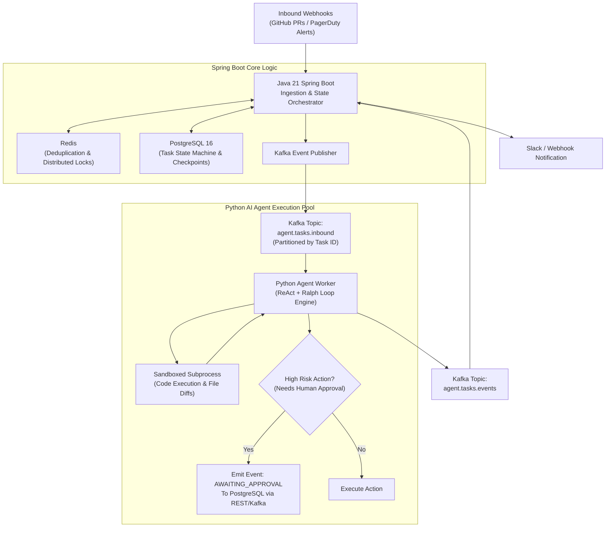

# Durable Agent Runtime ⚡

[-red.svg)](https://spring.io/)
[-blue.svg)](https://www.python.org/)
[](https://kafka.apache.org/)
[](https://www.postgresql.org/)
[-red.svg)](https://redis.io/)
[](LICENSE)

An enterprise-grade, **durable event-driven autonomous agent runtime** built with **Java (Spring Boot 3.x)**, **Apache Kafka**, **PostgreSQL**, **Redis**, and **Python**.

Standard agent frameworks (LangChain, CrewAI, AutoGen) run in-memory loops. If the host process crashes at turn 18 of a 20-step refactor or incident triage, the entire memory context is lost, wasting tokens and leaving partial side-effects.

**Durable Agent Runtime** treats autonomous agents as **durable distributed state machines**: bursty events (GitHub PRs, monitoring alerts) are buffered via **Apache Kafka**, deduplicated via **Redis**, state-managed via **PostgreSQL**, and executed by a **Python worker pool** running sandboxed ReAct and Ralph loops with transactional step checkpoints.

---

## 🎯 Why This Architecture? (Pragmatic Engineering Rationale)

In production, agents are distributed systems with distinct physical requirements:
1. **Bursty Webhooks vs. Slow LLM Inference**: Webhooks arrive in bursts of hundreds per second, while LLM inference takes 3–15 seconds per call. Ingesting synchronously over HTTP crashes services. We use **Java Spring Boot + Apache Kafka** as an elastic shock absorber.
2. **Alert Storm Deduplication**: When an infrastructure incident fires 50 cascading alerts in 2 minutes, we use **Redis `SETNX`** to drop duplicates and acquire distributed locks before burning expensive LLM tokens.
3. **Durable State Machine**: Agent tasks span minutes to hours. We persist task lifecycle states (`PENDING`, `INVESTIGATING`, `REQUIRES_APPROVAL`, `RESOLVED`) in **PostgreSQL** with ACID consistency and turn-level checkpoints.
4. **Sandboxed AI Execution**: The **Python AI Worker** consumes from Kafka, runs the ReAct/Ralph agent loop with sandboxed subprocess tools, and emits events back to Kafka.

---

## 🏗 End-to-End System Architecture



---

## 🚀 Key Modules & Tech Stack

### 1. Ingestion & Orchestrator Service (`orchestrator-service/`)
* **Framework**: Java 21, Spring Boot 3.3+, Spring Kafka, Spring Data JPA.
* **Responsibilities**:
  * High-throughput webhook ingestion endpoints with HMAC signature verification.
  * In-flight alert deduplication via Redis sliding-window hashes.
  * Managing task state transitions in PostgreSQL.
  * Publishing tasks to Kafka topics with retry topics and Dead-Letter Queues (DLQ).
  * WebSocket / SSE endpoint for real-time agent execution progress streaming.

### 2. Autonomous Agent Worker (`agent-worker/`)
* **Framework**: Python 3.12, Pydantic v2, Google GenAI / Anthropic SDK.
* **Responsibilities**:
  * Consumes tasks from Kafka consumer group with manual commit offset management.
  * Executes the **ReAct loop** (Reasoning + Acting) bounded by the **Ralph loop** (external environment verification).
  * Checkpoint persistence: writes execution traces after each turn.
  * Human-in-the-Loop approval gate for critical tools (e.g. cloud remediation commands, git push).

---

## 📊 System Resilience Comparison

| Capability | Naive Single-Script Agent | Durable Agent Runtime |
| :--- | :--- | :--- |
| **Ingestion Capacity** | Fails under burst (>10 concurrent HTTP calls) | **10,000+ req/sec (Buffered via Kafka)** |
| **Alert Storm Behavior** | Fires 50 separate redundant LLM loops | **Deduplicated in Redis (<5ms)** |
| **Worker Crash During Turn 8** | All context and work lost | **Resumes cleanly from PostgreSQL checkpoint** |
| **High-Risk Tool Safety** | Unrestricted shell execution | **Paused via State Machine for Human Sign-off** |

---

## 📁 Repository Structure

```text
durable-agent-runtime/
├── .github/workflows/ci.yml           # CI for Java & Python services
├── orchestrator-service/              # Java 21 / Spring Boot 3.x
│   ├── pom.xml                        # Maven dependencies (Spring Kafka, Data JPA, Redis)
│   └── src/main/java/com/platform/
│       ├── controller/                # Webhook & Approval REST endpoints
│       ├── service/                   # Task orchestrator & Redis deduplicator
│       ├── kafka/                     # Kafka producers, consumers & DLQ configs
│       └── model/                     # JPA entities (Task, StepAudit, Approval)
├── agent-worker/                      # Python 3.12 AI Worker
│   ├── pyproject.toml                 # Dependencies (Pydantic, Kafka, LLM SDKs)
│   └── src/
│       ├── consumer.py                # Kafka task listener with manual commits
│       ├── agent_loop.py              # ReAct / Ralph loop orchestrator
│       ├── checkpoint.py              # Task state checkpointing
│       └── sandbox.py                 # Subprocess execution sandbox
├── docs/
│   ├── overview.md                    # Detailed architectural specification
│   └── adr/                           # Architectural Decision Records
├── docker-compose.yml                 # Kafka, Zookeeper, PostgreSQL & Redis setup
└── README.md
```

---

## 🛠 Quickstart

### 1. Start Infrastructure (Kafka, Postgres, Redis)
```bash
docker compose up -d
```

### 2. Start the Spring Boot Orchestrator
```bash
cd orchestrator-service
./mvnw spring-boot:run
```

### 3. Start the Python Agent Worker
```bash
cd ../agent-worker
pip install -e .
python -m src.consumer
```

---

## 📜 Architectural Decision Records (ADRs)
- [ADR-001: Kafka for Asynchronous LLM Task Decoupling](docs/adr/001-kafka-decoupling.md)
- [ADR-002: Redis Deduplication during Incident Alert Storms](docs/adr/002-redis-deduplication.md)
- [ADR-003: Polyglot Java-Python System Boundary Design](docs/adr/003-polyglot-boundary.md)
