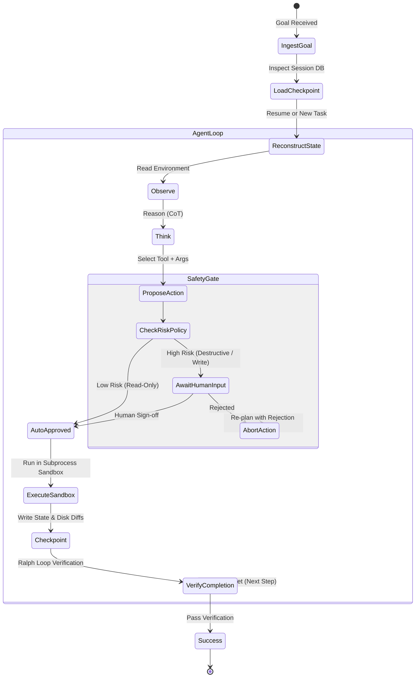

# Durable Agent Runtime 🤖

[](https://www.python.org/downloads/)
[](#agent-loop-design)
[](#checkpoint--resume)
[](#sandboxed-execution)
[](LICENSE)

An enterprise-grade, crash-resilient **autonomous agent runtime** designed for long-running, multi-step workflows.

Standard agent frameworks (LangChain, CrewAI, AutoGen) run in-memory loops. If the host process is killed at turn 18 of a 20-step refactor, the entire memory context is lost, wasting tokens, incurring duplicate API costs, and leaving partial side-effects.

**Durable Agent Runtime** treats autonomous agents as **durable distributed state machines**: every thought, observation, tool invocation, and environment change is checkpointed to persistent storage, enabling seamless crash recovery, deterministic replay, and strict human-in-the-loop safety.

---

## 🎯 The Engineering Problem

Autonomous agents in production face four fundamental failure modes:
1. **The Fragility of In-Memory Loops**: Network glitches, pod evictions, or memory limits kill long-running agent tasks midway, with zero resumption capability.
2. **Infinite Loops & Goal Drift**: Without explicit convergence criteria and step budgets, agents oscillate endlessly between conflicting tools.
3. **Unchecked Destructive Actions**: Agents execute irreversible side-effects (e.g. `rm -rf`, schema drops, email dispatches) without human confirmation gates.
4. **Context Poisoning**: A single malformed tool output fills the context window and cascades hallucinated reasoning into subsequent steps.

---

## 🏗 Architecture & Lifecycle



---

## 🚀 Key Architectural Highlights

### 1. Checkpoint & Resume Engine
* State snapshots are serialized into SQLite/PostgreSQL after every single tool turn.
* Persists:
  - Full conversation messages and token consumption.
  - Active tool outputs and intermediate variables.
  - Scratchpad state and diff tracking.
* **Resilience Guarantee**: If the process crashes at step $K$, restarting it replays zero redundant API calls and resumes immediately from step $K$.

### 2. Ralph Loop & ReAct Hybrid
* **Inner Loop (ReAct)**: Handles prompt reasoning and single-action dispatch (`Thought -> Action -> Observation`).
* **Outer Loop (Ralph)**: Treats the **environment (filesystem, git diff, test runner)** as the single source of truth rather than trusting the LLM's own self-reported completion.
* The loop only terminates when external deterministic assertions pass (e.g. `pytest` exit code = `0`).

### 3. Sandboxed Subprocess Isolation
* All code execution (`python`, `bash`, file mutations) runs within an isolated worker process.
* Enforces hard limits:
  - Max execution timeout (e.g., 30s per script).
  - Memory ceilings (preventing OOM loops).
  - Strict directory traversal boundaries (sandboxed to `./workspace`).

### 4. Human-in-the-Loop (HITL) Gatekeeper
* Tools are tagged with risk profiles: `READ_ONLY`, `MUTATION`, or `CRITICAL`.
* Actions classified as `CRITICAL` pause execution, emit a webhook notification, and wait for explicit human authorization before executing.

---

## 📊 Reliability & Resilience Benchmarks

| Scenario | Standard In-Memory Agent | Durable Agent Runtime |
| :--- | :--- | :--- |
| **Crash at Step 12/15** | Fatal crash; 100% tokens lost; restarts at Step 1 | **Resumes at Step 12 in <50ms** |
| **Duplicate Side-Effects** | Common upon blind retries | **Zero (Guaranteed via Idempotency Keys)** |
| **Destructive Command Blast Radius** | Unrestricted shell access | **Sandboxed with Human Confirmation Gate** |
| **Max Turn Enforcement** | Often loops indefinitely | **Strict hard stop + graceful rollback** |

---

## 📁 Repository Structure

```text
durable-agent-runtime/
├── .github/workflows/ci.yml       # CI tests & crash recovery verification
├── benchmarks/                    # Loop throughput & memory persistence tests
├── docs/
│   ├── overview.md                # Comprehensive system specification
│   └── adr/                       # Architectural Decision Records (ADR-001, ADR-002)
├── src/
│   ├── core/                      # Agent state machine & loop orchestrator
│   ├── storage/                   # Checkpointing engines (SQLite, Postgres)
│   ├── sandbox/                   # Subprocess isolation & resource limiters
│   ├── safety/                    # Risk classification & HITL approval gates
│   └── tools/                     # Base tool registry with idempotency keys
├── tests/                         # Pytest test suite (including simulated crash recovery)
├── docker-compose.yml             # Postgres persistence backend
└── pyproject.toml                 # Package configuration
```

---

## 🛠 Quickstart

### 1. Installation
```bash
git clone https://github.com/your-username/durable-agent-runtime.git
cd durable-agent-runtime
pip install -e .
```

### 2. Run a Resilient Agent Task
```bash
python -m src.cli run --task "Refactor src/parser.py and ensure all unit tests pass" --checkpoint-db "./agent.db"
```

### 3. Test Crash Recovery
Run the automated crash recovery test to witness state persistence in action:
```bash
pytest tests/test_crash_recovery.py -v
```

---

## 📜 Architectural Decision Records (ADRs)
- [ADR-001: Ralph Loop as Outer Control Loop](docs/adr/001-ralph-loop-orchestration.md)
- [ADR-002: SQLite WAL Mode for Sub-Millisecond Checkpointing](docs/adr/002-sqlite-wal-checkpointing.md)
- [ADR-003: Subprocess Sandboxing vs. Docker-in-Docker](docs/adr/003-subprocess-sandboxing.md)
